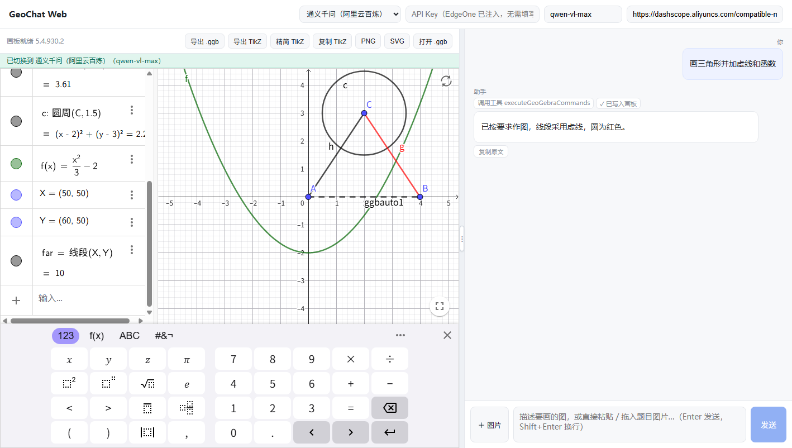

# Geogebra Webchat — 用一句话画出数学图形

> 在浏览器里用自然语言创建可交互的数学图形。输入一句话，AI 自动翻译成 GeoGebra 命令并当场画出来，同时把推导过程讲给你听。

[](https://console.cloud.tencent.com/edgeone/makers/new?repository-url=https%3A%2F%2Fgithub.com%2Fliangdabiao%2FGeogebra-WebChat)

---

## 这是什么

[GeoGebra](https://www.geogebra.org/) 是全球上亿人使用的动态数学软件，画几何图、看函数图像都很好用——但要用它，得先学会它那套命令语法。

**Geogebra Webchat 把这层门槛拆掉了：**

左边是画板，右边是聊天框。你输入「画一个直角三角形，把三个角的度数标出来」，几秒后画板上出现三角形，右侧同时给出解题思路。

```
┌──────────────────────────┬─────────────────────────┐
│                          │  画一个直角三角形，       │
│      GeoGebra 画板       │  标出三个角的度数         │
│                          │                         │
│         △                │  ┌───────────────────┐  │
│                          │  │ 已按要求作图……      │  │
│                          │  └───────────────────┘  │
├──────────────────────────┴─────────────────────────┤
│  ＋图片   [ 输入你的数学题…              ] [发送] │
└───────────────────────────────────────────────────┘
```

**适合谁**

| 你是 | 你能得到什么 |
|---|---|
| 学生 / 教师 | 不用记命令，说人话就能得到标准图形，还能导出成课件素材 |
| 数学爱好者 | 快速可视化函数、几何关系、数学模型 |
| 写论文 / 做课件的人 | 一键导出 `.ggb`、TikZ、PNG、SVG，直接放进 LaTeX 或 GeoGebra |
| 前端开发者 | 一个完整的「AI + 专业软件」集成范例：SolidJS + Vercel AI SDK + GeoGebra |

---

## 在线体验（打开就能试）

| 入口 | 地址 | 说明 |
|---|---|---|
| **EdgeOne（国内推荐）** | https://geogebra-webchat.liangdabiao.com/ | 国内线路更快，已绑自定义域 |
| Cloudflare 自定义域 | https://geogebra-webchat.348349.xyz/ | 海外访问更稳 |
| Cloudflare Pages 默认域 | https://geogebra-webchat.pages.dev/ | 上面那个站点的备用入口 |

三个入口是同一份代码、同一套配置，功能完全一致。**不需要注册，不需要填 Key，打开就能用。**

> EdgeOne CLI 部署时会额外打印一个 `*.edgeone.cool` 链接，那是带临时令牌的预览地址（几小时后失效），不是正式入口。

---

### 实际效果

一句话，得到带样式、带标注的完整图形：



更多例子：

- 「画一个四面体并画出它的外接球」
- 「用图证明勾股定理」
- 「李嘉图贸易模型」
- 「各种圆锥曲线」


---

## 三种上手方式

### 方式一：直接用（0 分钟）

打开上面的链接，在聊天框里输入你的数学题，或者点「＋图片」上传题目照片。

### 方式二：部署一份自己的（3 分钟）

先准备一个模型 API Key（默认用 [DeepSeek 官方 API](https://platform.deepseek.com/)，`deepseek-flash` 这个模型自带读图能力）。

然后点顶部那个 **「一键部署」** 按钮，或者手动执行：

```bash
npm install -g edgeone     # 安装 EdgeOne CLI
edgeone login               # 登录
edgeone makers deploy -n geogebra-webchat --skip-ai-gateway-sync
```

部署完成后，把模型配置写进环境变量：

```bash
edgeone makers env set MODEL_BASE_URL "https://api.deepseek.com/v1" -e production
edgeone makers env set MODEL_NAME "deepseek-flash" -e production
edgeone makers env set MODEL_API_KEY "你的Key" -e production
```

**Key 只存在服务端，访客打开网页时看不到、也用不到你的 Key。**

### 方式三：本地跑（改代码用）

需要 [Node.js 20+](https://nodejs.org)。

```bash
npm install
edgeone makers dev          # 或 npm run dev
```

打开 `http://localhost:8088`，前端热更新、云函数自动重启。

---

## 能做什么

### 一、说人话就能作图

直接描述你的数学问题，AI 会翻译成 GeoGebra 命令并执行。常见的都能画：

- 几何图形：三角形、多边形、圆、圆弧、扇形、角与角平分线
- 特殊图形：三角形四心、垂足、内心外心、相似与全等
- 函数图像：一次/二次/三角/指数/对数函数
- 测量与变换：交点、距离、角度、向量、旋转、平移、缩放
- 3D：空间几何体、截面
- 非数学场景：经济学图表、物理模型示意图

画完之后，你可以像用 GeoGebra 一样**拖动点、缩放、旋转**，图形和代数区实时联动。

### 二、拍照读题

点输入框左侧的「＋图片」，可以上传、粘贴或直接拖入题目照片。模型读图后自动生成作图命令。

图片会自动压缩（长边 ≤1280px，转 JPEG），一张题图通常只有几百 KB。

> 需要所选模型支持图片输入。DeepSeek `deepseek-flash`、通义千问 `qwen-vl-max`、智谱 `glm-4v-plus` 都支持。

### 三、把图拿走

画板上方工具栏提供六种导出方式：

| 按钮 | 导出内容 | 适合用途 |
|---|---|---|
| **导出 .ggb** | GeoGebra 原生构造文件 | 交给 GeoGebra 桌面版继续编辑 |
| **导出 TikZ** | 完整 LaTeX 文档 | 直接编译进论文，保留坐标轴、网格、角度标记 |
| **精简 TikZ** | 精简 LaTeX 文档 | 代码量小得多，好二次修改 |
| **复制 TikZ** | `tikzpicture` 片段 | 贴进你自己现有的 LaTeX 文件 |
| **PNG** | 位图 | 放 PPT、贴文档 |
| **SVG** | 矢量图 | 无限放大不糊 |
| **打开 .ggb** | — | 载入已有 `.ggb` 文件继续改 |

**导出的 `.ggb` 能被 GeoGebra 桌面版正常打开**（项目会自动补上桌面版需要的缩略图）。如果桌面版仍提示打不开，试试用软件内「菜单 → 打开 → 从本机选择」。

TikZ 只覆盖 2D 图形视图，3D 图请用 PNG/SVG 或 `.ggb`。

### 四、换一个模型服务商

右上角有下拉框，一键切换：

| 预设 | 接口地址 | 默认模型 | 能读图 |
|---|---|---|---|
| 服务端默认（免填 Key） | 由部署方配置 | 由部署方配置 | 取决于配置 |
| DeepSeek 官方 | `https://api.deepseek.com/v1` | `deepseek-flash` | ✅ |
| 通义千问（阿里云百炼） | `https://dashscope.aliyuncs.com/compatible-mode/v1` | `qwen-vl-max` | ✅ |
| 智谱 GLM | `https://open.bigmodel.cn/api/paas/v4` | `glm-4v-plus` | ✅ |
| 月之暗面 Kimi | `https://api.moonshot.cn/v1` | `moonshot-v1-8k` | ❌ |
| 硅基流动 SiliconFlow | `https://api.siliconflow.cn/v1` | `Qwen/Qwen2.5-VL-72B-Instruct` | ✅ |
| OpenAI 官方 | `https://api.openai.com/v1` | `gpt-4o-mini` | ✅ |
| 自定义 | 手填 | 手填 | 取决于模型 |

- 切到「服务端默认」会恢复占位 Key，真实密钥由云函数注入。
- 切到其它服务商时占位 Key 会自动清空，你需要填那个服务商的 Key。
- **你填的 Key 只存在你自己的浏览器 `localStorage` 里**，不上传服务器、不进仓库。

### 五、几个顺手的细节

- **分栏可拖**：左右之间有条把手，拖动即可调整宽度，比例会记住。双击恢复默认。
- **生成中有提示**：AI 作图要跑十几秒，这期间会显示当前阶段（读题 / 执行作图 / 写解答）和已等待秒数。
- **公式能正常复制**：回复里的公式是排版渲染的，直接框选复制会得到格式碎片；点回复下方的「**复制原文**」可以拿到干净的 Markdown 源码。
- **画板不会溢出**：窗口缩放、按钮折行、分栏拖动时，画板都会跟着重算尺寸，不会盖住聊天区。

---

## 工作原理

### 一次对话里发生了什么

```
   你输入「画一个外接圆是半径 2 的正三角形」
        │
        ▼
  ① 浏览器里发起请求
     如果附了图，先压缩成 JPEG
        │
        ▼
  ② 转到 /llm-proxy（云函数）
     · 补上你的服务端 Key
     · 跨域、请求体大小、流式响应都在这层处理
        │
        ▼
  ③ 模型返回一串 GeoGebra 命令
     "A=(0,0)" "B=(4,0)" "c=Circle(C,2)" …
        │
        ▼
  ④ 画板逐条执行命令 → 图形出现
        │
        ├────→ 模型再写一段文字解释，流式输出到聊天框
        └────→ 你可以点工具栏导出成 .ggb / TikZ / PNG / SVG
```

### 几个关键设计

**为什么要有云函数这一层？**
浏览器直接调模型 API 会遇到三个问题：跨域被拦、你的 Key 会暴露在网页源码里、不同厂商的接口格式各不相同。`/llm-proxy` 把这些一次性处理掉：它从服务端环境变量取 Key、加到请求头再转发、只允许转发到白名单里的厂商域名、并且把模型的流式响应原样送回浏览器。

**为什么 AI 的循环跑在浏览器里？**
这样 GeoGebra 命令可以立刻执行、立刻看到图形，不用等一个完整回复。模型每生成一批命令就调一次工具，画板同步更新；模型看到画好的图形再继续写解释或修图。目前每轮最多 6 步。

**图片为什么只在第一轮发送？**
对话是多轮的，但图片只在最开始那一次有用。后续轮次自动把历史里的图片剥掉，避免每一轮都重传一遍大图——这对请求体大小和响应速度都是很大的节省。

**TikZ 为什么分完整和精简两档？**
GeoGebra 引擎自己导出的 LaTeX 最忠实（坐标轴、角度标记、线型颜色全在），但代码冗长；而追求好改的版本又需要去坐标轴、去网格、合并重复的绘图命令、把小数点后多余的位数砍掉。所以两种都给，用哪种看你的场景。

**导出会不会漏图形？**
会做一道校验：导出前先从画板读取一份「现在有哪些对象」清单，逐个对照导出的 LaTeZ 里有没有对应的绘图语句。如果发现某个对象没被画出来，会自动把它补进文件，并在提示条里说明补了几个。

### 技术栈

| 层 | 用什么 |
|---|---|
| 界面 | SolidJS + Vite |
| AI | Vercel AI SDK v6，`streamText` + 工具调用循环，跑在浏览器里 |
| 公式渲染 | KaTeX（本地打包，不依赖外部 CDN） |
| 图形引擎 | GeoGebra 5.0 web3d（仓库自带本地构建） |
| 后端 | 一个 `/llm-proxy` 云函数，EdgeOne 与 Cloudflare Pages 共用同一份处理逻辑 |
| 部署 | EdgeOne Pages 与 Cloudflare Pages 双平台并存，前端代码零差异 |

---

## 目录结构

```
├── index.html
├── src/
│   ├── App.tsx              # 聊天 + 画板布局、导出工具栏、图片上传
│   ├── ai-client.ts         # AI 工具循环、多模态消息、读图提示词
│   ├── geogebra.ts          # GeoGebra 加载、命令执行、导出封装
│   ├── styles.css
│   └── lib/
│       ├── normalize.ts     # 命令规范化（中文别名 → 英文命令）
│       ├── export.ts        # 下载 / 复制等通用文件工具
│       ├── tikz.ts          # TikZ 生成、精简、覆盖校验、快照兜底
│       ├── providers.ts     # 预置模型服务商清单
│       ├── ggb.ts           # .ggb 缩略图补全与文件头校验
│       └── image.ts         # 图片压缩与 base64 产出
├── cloud-functions/
│   └── llm-proxy/           # 通用 LLM 代理（两个平台共用）
├── functions/
│   └── llm-proxy.ts         # Cloudflare Pages Functions 适配层
├── public/geogebra/         # 本地 GeoGebra 5.0 静态资源
├── doc/                     # 开发笔记、效果截图、参考文档
├── .env.example             # 环境变量模板（复制为 .env；.env 不入库）
└── edgeone.json             # EdgeOne 部署配置
```

---

## 环境变量

**两组二选一，不要混填：**

| 变量 | 组别 | 说明 |
|---|---|---|
| `MODEL_BASE_URL` | A · 自有厂商 | OpenAI 兼容接口地址，默认 `https://api.deepseek.com/v1` |
| `MODEL_NAME` | A · 自有厂商 | 默认 `deepseek-flash`（支持图片输入） |
| `MODEL_API_KEY` | A · 自有厂商 | 厂商 Key，仅服务端注入，不进浏览器 |
| `MAKERS_MODELS_KEY` | B · EdgeOne 内置网关 | Makers 网关 Key（免费额度 50 万 token/月） |
| `MAKERS_MODEL` | B · EdgeOne 内置网关 | 留空即用 `@makers/deepseek-v4-flash` |

> 填了 `MAKERS_MODELS_KEY` 会**整组**切到 EdgeOne 网关并忽略 `MODEL_*`；反之 Key 和地址必须成组切换，否则会「拿 A 的 Key 打 B 的网关」→ 401。
> 页面右上角的输入框随时可以临时覆盖，方便调试。

---

## 部署到 EdgeOne

### 第 1 步：准备

```bash
npm install -g edgeone
edgeone login
```

### 第 2 步：写环境变量

```bash
edgeone makers env set MODEL_BASE_URL "https://api.deepseek.com/v1" -e production
edgeone makers env set MODEL_NAME "deepseek-flash" -e production
edgeone makers env set MODEL_API_KEY "你的Key" -e production
```

### 第 3 步：部署

```bash
edgeone makers deploy -n geogebra-webchat --skip-ai-gateway-sync
```

`--skip-ai-gateway-sync` 用来阻止 CLI 自动把内置网关 Key 写回配置（否则会覆盖你自己的厂商配置）。

---

## 部署到 Cloudflare Pages

前端代码零改动，同一份 `dist` 和同一组变量即可部署。

### 第 1 步：构建

```bash
npm install
npm run build          # 产物 dist/，约 50MB / 206 个文件
```

Pages 免费版上限 20,000 文件、单文件 25 MiB；本项目最大单文件约 10 MB，余量充足。

### 第 2 步：创建项目并写入变量

```bash
npx wrangler login
npx wrangler pages project create geogebra-webchat --production-branch main
npx wrangler pages secret bulk .env --project-name geogebra-webchat
```

`.env` 里的三个 `MODEL_*` 会作为加密 Secret 存进 Pages 的 production 环境，浏览器拿不到。

### 第 3 步：部署

```bash
npx wrangler pages deploy dist --project-name geogebra-webchat --branch main
```

### 第 4 步：自定义域（必须补 DNS）

Pages **不会自动创建 DNS 记录**。除了在控制台添加自定义域，还要在 DNS 里手动加一条：

| 类型 | 名称 | 目标 | 代理状态 |
|---|---|---|---|
| CNAME | `geogebra-webchat`（或你的子域） | `geogebra-webchat.pages.dev` | 已代理 / Proxied（橙云） |

不加这条，域名会一直停在 `pending`，提示 `CNAME record not set`。

> Wrangler 的 OAuth 登录只有 `pages:write` / `zone:read`，**不含 DNS 编辑权限**，API 加记录会返回 403。请在 Cloudflare 控制台的 DNS 页面操作，或改用带 `Zone:DNS:Edit` 权限的 API Token。

### 也可以接 GitHub 自动部署

在 Pages 项目设置里连上 GitHub 仓库：构建命令 `npm run build`、输出目录 `dist`、生产分支 `main`，以后 push 即自动部署。和 `wrangler pages deploy` 二选一，不要混用同一个项目。

### 国内访问提醒

Cloudflare 免费版没有中国大陆节点，`pages.dev` 和自定义域在国内部分运营商存在 DNS 污染、晚高峰不稳。本项目首次要拉约 50MB 的 GeoGebra 资源，国内加载会明显慢于 EdgeOne。

**建议把 Cloudflare 定位成海外镜像 / 演示 / 备份入口，国内主站用 EdgeOne。**

---

## 常见问题

<details>
<summary><b>页面能用，但我填了自己的 Key 就报 401？</b></summary>

切换到与服务端配置不同的服务商时，界面会**自动清掉占位 Key**——这时必须填该服务商的真实 Key，否则就是拿空 Key 去请求。填错厂商也会 401（比如拿 DeepSeek 的 Key 去打通义千问）。
</details>

<details>
<summary><b>提示 Insufficient remaining quota（402）？</b></summary>

只在用 **EdgeOne 内置网关**时出现，表示免费额度用尽了：每月 50 万 token，**按账号算、所有项目共享**，换个网关 Key 不会重置。

处理办法：① 在 Makers 控制台绑定自有厂商 Key，模型名改成 `provider/model`；② 提交工单提额；③ 改用第三方厂商 API（见「环境变量」）。
</details>

<details>
<summary><b>Cloudflare 自定义域一直 pending / CNAME record not set？</b></summary>

自定义域需要在 DNS 里手动加 CNAME，见「部署到 Cloudflare Pages · 第 4 步」。加好后证书自动签发，几分钟内变成 active。
</details>

<details>
<summary><b>画着画着少了一条线 / 画板突然全清空？</b></summary>

这是旧版本的两个已知问题，新版已经修好了。如果你部署的是旧版本，可以先手动改个名绕开（比如把和函数同名的线段 `f` 改成 `f1`）。

新版里如果代数区出现 `ggbauto1` 这类名字，那是被保护下来的原对象（自动改名是为了避免和函数重名），是正常的。

细节见 [开发笔记 · 根因分析](doc/开发笔记.md#一图形莫名消失的两个根因与修复)。
</details>

<details>
<summary><b>复制出来的公式重复、或者被拆成单字符？</b></summary>

直接框选复制时，KaTeX 的排版方式（用 CSS 定位分式、根号、上下标）有时会带出格式碎片。点回复下方的「**复制原文**」，拿到的就是干净的 Markdown。
</details>

<details>
<summary><b>3D 视图里那个斜的白色四边形是什么？</b></summary>

是坐标系的 xy 平面，视角旋转后的正常显示，不是界面溢出。想看完整画板，用 GeoGebra 自带的全屏按钮，或把分栏往右拖宽一些。
</details>

<details>
<summary><b>导出的 .ggb 桌面版打不开？</b></summary>

优先升级到最新版 GeoGebra Classic，并改用软件内「菜单 → 打开 → 从本机选择」而不是双击文件（部分沙盒版桌面应用双击会报 `Cannot open file`）。也可以在网页版 `geogebra.org/classic` 里打开同一文件交叉验证。
</details>

<details>
<summary><b>能不能用我自己的模型？</b></summary>

能，只要它兼容 OpenAI 的 `chat/completions` 接口格式。在右上角下拉选「自定义」，填 Base URL、模型名和 API Key 即可。

注意两点：一是这个域名必须被 `/llm-proxy` 的白名单放行，否则请求会被拒（403 `target host not allowed`），加白名单要改 `cloud-functions/llm-proxy/index.ts` 的 `ALLOWED_HOSTS`；二是 Key 只存在你浏览器本地，清掉浏览器数据就没了。
</details>

---

## 更新记录

### 2026-11 · 图形丢失修复、TikZ 双版本、服务商切换

- 修复「画着画着少一条线」和「画板突然全空」两个问题（根因分析见 [开发笔记](doc/开发笔记.md#一图形莫名消失的两个根因与修复)）
- TikZ 导出分两档：完整版保留坐标轴与角度标记，精简版去掉坐标轴/网格、合并重复绘图、坐标取整
- 导出前增加覆盖校验：发现图形缺失会自动补进 LaTeX 并提示
- 顶栏新增模型服务商下拉，一键切换 6 家厂商
- 系统提示词内置 GeoGebra 官方指令速查，作图成功率明显提升

### 2026-11 · 导出与多模态

- 新增 `.ggb` 导出与「打开 .ggb」回载，另有 PNG、SVG 导出
- 新增 TikZ 导出（完整 `.tex` + 可复制的 `tikzpicture` 片段）
- 输入框新增图片上传 / 粘贴 / 拖入，模型读图后作图
- 默认模型切换为支持视觉输入的 `deepseek-flash`

### 2026-11 · Cloudflare Pages 双平台部署

- 新增 Cloudflare Pages 部署，与 EdgeOne 站点并存，前端零改动
- 补充自定义域 DNS 要求与国内访问速度提醒

### 2026-11 · 公式本地化与画板自适应

- KaTeX 改为本地打包，首屏不再请求外部 CDN
- 画板尺寸跟随容器实时重算，不再溢出盖住聊天区
- 新增左右分栏拖动，宽度比例会记住
- `.ggb` 导出补上桌面版需要的缩略图，提升兼容性

### 2026-11 · 等待提示与公式复制修复

- 生成中显示分阶段状态与已等待秒数
- 公式改为单份渲染，修复复制出「2 2」「B D E BDE」这类重复字符
- 回复新增「复制原文」按钮，一键拿到规范 Markdown

---

## 延伸阅读

- [开发笔记（排障与实现细节）](doc/开发笔记.md)
- [GeoGebra Apps 嵌入说明](doc/GeoGebra%20Apps%20Embedding.md)
- [公式处理笔记](doc/公式处理.md)

## 许可证

MIT
