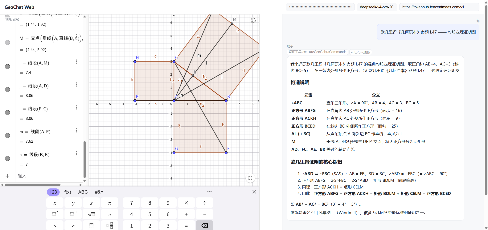
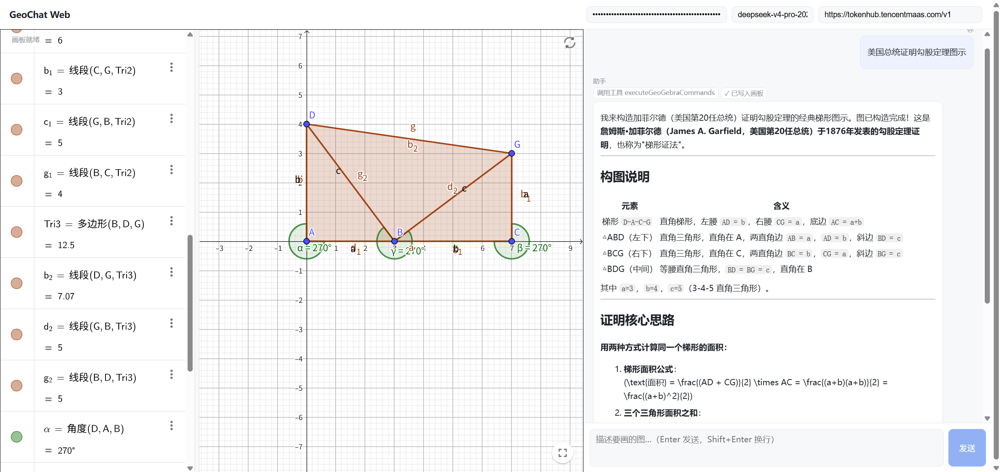
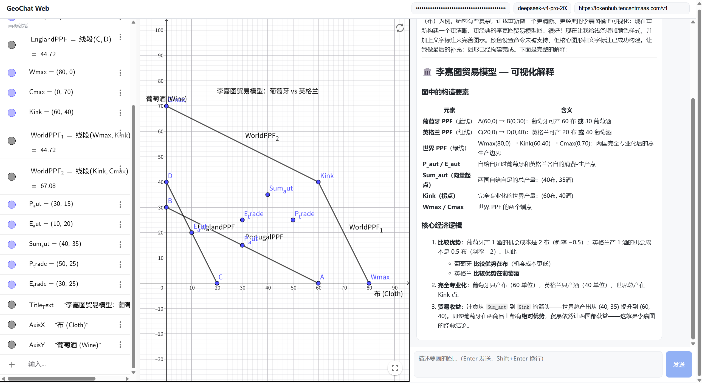
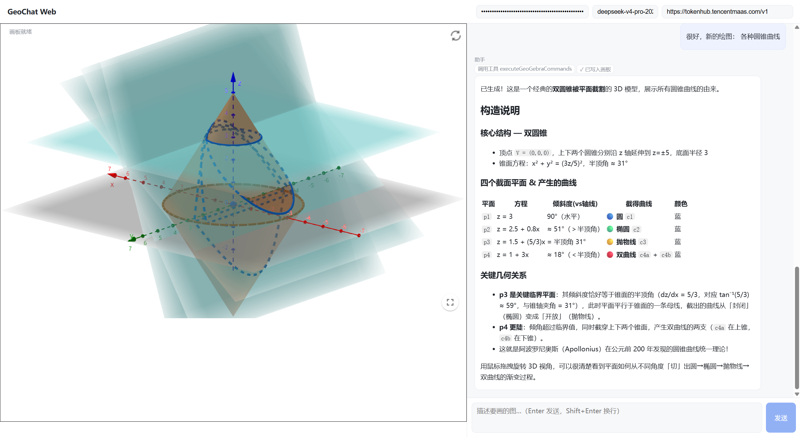

# Geogebra Webchat — AI 驱动的数学几何画板

> 一句话在浏览器里创建可交互的数学图形。输入自然语言描述，AI 自动生成 GeoGebra 命令并在实时画板中呈现。

[](https://console.cloud.tencent.com/edgeone/makers/new?repository-url=https%3A%2F%2Fgithub.com%2Fliangdabiao%2FGeogebra-WebChat)

---

## 快速配置（环境变量）

把 `.env.example` 复制为 `.env` 并填入自己的 Key；线上再用 `edgeone makers env set KEY VALUE -e production` 写入项目环境变量。

| 变量 | 必填 | 说明 |
|---|---|---|
| `MODEL_BASE_URL` | 是 | OpenAI 兼容接口地址，默认 `https://api.deepseek.com/v1` |
| `MODEL_NAME` | 是 | 模型名，默认 `deepseek-flash`（支持图片输入，可图片读题） |
| `MODEL_API_KEY` | 是 | 厂商 Key，仅由云函数服务端注入，不暴露给浏览器 |

也可以改用 EdgeOne Makers 内置网关（只填 `MAKERS_MODELS_KEY`），两组二选一，详见「环境变量」与「部署到 EdgeOne」。

---

## 谁适合用这个项目？

- **学生和教师**：想要快速创建数学几何图形辅助学习和教学，无需学习复杂的 GeoGebra 命令语法
- **数学/科研爱好者**：需要可视化函数、几何关系或数学模型
- **前端开发者**：对 AI 集成（Vercel AI SDK）、SolidJS 实践、数学可视化感兴趣
- **教育技术探索者**：研究如何将大语言模型与专业软件结合，降低使用门槛

---

## 项目背景与解决的需求

GeoGebra 是一款优秀的动态数学软件（Geometry + Algebra），全球用户超过 1 亿。然而，使用 GeoGebra 需要掌握其特定的命令语法，对初学者构成门槛。

与此同时，大语言模型在理解和生成自然语言方面的能力不断提升。**Geogebra Webchat 的核心思路**：让用户用自然语言描述数学问题，AI 自动转化为 GeoGebra 命令，在画板上实时构造图形，并用文字解释几何关系。

这带来了几个根本性的变化：
- **降低门槛**：不用记命令，说人话就行
- **提高效率**：一句「画一个正四面体并标出外接球」秒出结果
- **拓展场景**：经济学图表、物理模型、3D 几何都可以用自然语言生成

---

## 核心功能

- **自然语言作图**：输入数学/几何问题，AI 自动生成并执行 GeoGebra 命令
- **实时交互画板**：拖拽、缩放、旋转，图形与代数区联动
- **流式 Markdown 渲染**：AI 解释步骤实时显示，公式用 KaTeX 渲染
- **2D / 3D 支持**：平面几何和立体图形均可
- **多模型兼容**：通过 OpenAI 兼容 API，可切换任意大模型（DeepSeek、通义千问、GPT 等）
- **服务端 Key 注入**：可选隐藏 API Key，不暴露给浏览器
- **多格式导出**：一键导出 `.ggb`、PGF/TikZ `.tex`、PNG、SVG，并可复制 `tikzpicture` 片段
- **打开 .ggb**：载入已有构造继续编辑
- **图片读题**：输入框支持上传 / 粘贴 / 拖入图片，模型读图后生成 GeoGebra 命令并作图

---

## 导出与图片上传

画板上方工具栏提供 `.ggb`、TikZ、PNG、SVG 导出与「打开 .ggb」。

- `.ggb` 走 GeoGebra 的 `getBase64()`，得到标准二进制构造文件，可被桌面版直接打开；「打开 .ggb」用 `setBase64()` 回载。
- TikZ 优先调用本地 GeoGebra 5.0 构建里的 `exportPGF(callback)`（该 API 未列入官方文档）；若超时或失败，自动降级到基于对象快照的自研生成器，最后再降级为导出 SVG。产物是可编译的完整 `.tex`，「复制 TikZ」给的是 `tikzpicture` 片段。PGF/TikZ 只覆盖 2D 图形视图。
- 图片上传后统一缩放到长边 ≤1280px 并转 JPEG，控制在几百 KB，最多 4 张。这是为了适应 EdgeOne Cloud Functions 6MB 请求体上限；图片只在工具循环首步发送，历史轮自动剥离，避免 6 步循环重复传图。
- 图片以 base64 嵌在 OpenAI 兼容的 `image_url` 里经 `/llm-proxy` 转发，因此**所用模型需要支持图片输入**。

---

## 实际效果

```
输入：Draw a triangular pyramid (tetrahedron) and then draw its circumscribed sphere
输入：美国总统证明勾股定理图示
输入：经济学的李嘉图贸易理论
输入：各种圆锥曲线
```






---

## 技术栈

- **前端**：SolidJS + Vite，`marked` 渲染 Markdown，KaTeX 渲染公式
- **AI**：Vercel `ai` SDK v6，浏览器内 `streamText({ stopWhen: stepCountIs(6) })` 跑工具调用循环
- **GeoGebra**：仓库自带 GeoGebra 5.0 web3d 静态资源（`public/geogebra/HTML5/5.0/web3d/`），由 `deployggb.js` 加载。导出 `.ggb` / PGF-TikZ / PNG / SVG 依赖该本地构建提供的 applet API，因此不能换回 CDN 版本
- **后端**：EdgeOne 云函数 `cloud-functions/llm-proxy`，透明转发 + 解决 CORS + 服务端 Key 注入
- **部署**：EdgeOne Pages，`edgeone makers deploy` 一条命令上线

## 目录

```
├── index.html
├── src/
│   ├── App.tsx              # 聊天 + 画板布局、导出工具栏、图片上传 UI
│   ├── ai-client.ts         # AI 工具循环（核心）、多模态消息、读图 prompt
│   ├── geogebra.ts          # 本地 GeoGebra 加载、命令执行、导出/检视 API 封装
│   ├── styles.css
│   └── lib/
│       ├── normalize.ts     # 命令规范化（中文别名→英文）
│       ├── export.ts        # .ggb / TikZ / SVG / PNG 导出与 TikZ 降级生成
│       └── image.ts         # 图片压缩与 base64 产出
├── cloud-functions/
│   └── llm-proxy/           # EdgeOne 云函数：LLM 请求代理
├── public/geogebra/         # 本地 vendor 的 GeoGebra 5.0 静态资源
├── doc/                     # 效果截图与参考文档
├── .env.example             # 环境变量模板（复制为 .env 使用；.env 不入库）
└── edgeone.json             # EdgeOne 部署配置
```

---

## 部署到 EdgeOne（3 步）

### 准备

**① 模型 Key** —— 项目默认直连 DeepSeek 官方 `deepseek-flash`（自带视觉输入，可图片读题），需要一个 DeepSeek API Key。也可以改用 EdgeOne Makers 内置网关，见下面「环境变量」。

**② 部署工具**：

```bash
npm install -g edgeone     # 安装 EdgeOne CLI
edgeone login              # 登录你的 EdgeOne 账号
```

### 第 1 步：配置 .env

把 `.env.example` 复制为 `.env`，填入自己的 Key：

```
MODEL_BASE_URL=https://api.deepseek.com/v1
MODEL_NAME=deepseek-flash
MODEL_API_KEY=你的Key
```

Key 只保存在服务端，不会暴露给浏览器——访客打开网页无需任何配置。线上还要把这三个变量写入项目环境变量：

```bash
edgeone makers env set MODEL_BASE_URL "https://api.deepseek.com/v1" -e production
edgeone makers env set MODEL_NAME "deepseek-flash" -e production
edgeone makers env set MODEL_API_KEY "你的Key" -e production
```

### 第 2 步：部署

```bash
edgeone makers deploy -n geogebra-webchat --skip-ai-gateway-sync
```

`--skip-ai-gateway-sync` 会阻止 CLI 自动把内置网关 Key 写回配置（否则会覆盖自有厂商配置）。完成后输出专属网址。

### 第 3 步：打开即用

浏览器打开网址，直接输入数学题或上传题目图片；右上角可临时覆盖模型名与接口地址。

## 本地开发（可选）

前置：安装 [Node.js 20+](https://nodejs.org) 和 [EdgeOne CLI](https://pages.edgeone.ai/document/edgeone-cli)（`npm install -g edgeone`）。

```bash
npm install
edgeone makers dev
```

打开 `http://localhost:8088` 即可边改边看（前端改动热更新，云函数改动自动重启）。

## 环境变量

**两组二选一，不要同时填写**：

| 变量 | 组别 | 说明 |
|---|---|---|
| `MODEL_BASE_URL` | A · 自有厂商 | OpenAI 兼容地址，默认 `https://api.deepseek.com/v1` |
| `MODEL_NAME` | A · 自有厂商 | 默认 `deepseek-flash`（自带视觉输入） |
| `MODEL_API_KEY` | A · 自有厂商 | 自有厂商 Key，服务端注入，不进浏览器 |
| `MAKERS_MODELS_KEY` | B · 内置网关 | EdgeOne Makers 网关 Key（免费额度 50 万 token/月） |
| `MAKERS_MODEL` | B · 内置网关 | 留空即用 `@makers/deepseek-v4-flash` |

> 填了 `MAKERS_MODELS_KEY` 会**整组**切到 EdgeOne 网关并忽略 `MODEL_*`；反之 Key 与端点必须成组切换，否则会「拿 A 的 Key 打 B 的网关」→ 401。
> 线上变量用 `edgeone makers env set KEY VALUE -e production` 写入，部署时加 `--skip-ai-gateway-sync`。
> 页面右上角的输入框仍可直接覆盖，方便临时调试。

## 常见问题

### Insufficient remaining quota（402）

这个错误只会在**使用 EdgeOne Makers 内置网关**时出现，表示内置模型免费额度已用尽：每月 50 万 token，**按账号维度计算、所有项目共享**，因此换一个新的网关 Key 不会重置额度，改用其它 `@makers/*` 模型也一样；账号未绑定 BYOK 厂商密钥时，网关里也没有可切换的付费模型。

可选处理：

1. **绑定自有厂商密钥（BYOK，改动最小）**：Makers 控制台 → Models 绑定厂商 Key，再把模型名改成 `provider/model`（如 `deepseek/deepseek-chat`）。
2. **提交工单提额，或等下个计费周期重置**：免费额度以开通 Makers 服务的日期为周期起点按月重置。
3. **直连第三方模型服务**：按上面 A 组配置 `MODEL_*`，或在页面右上角填写自己的 `Base URL` + 模型名 + `API Key`。切到与服务端配置不同的地址时，界面会自动清掉占位 Key，此时必须填真实 Key，否则会得到 401。

> 当前默认配置已是 DeepSeek 官方 API，不会出现该错误；若自有 Key 返回 402，通常是账户余额不足。

### POST /llm-proxy 返回 200 但响应体为空

云函数曾直接把上游 `ReadableStream` 和全部响应头透传，EdgeOne 线上运行时会返回 200 却丢掉 body（本地 `makers dev` 正常，容易漏测）。修复方式：只透传 `content-type` / `cache-control` 等安全头，剔除 `transfer-encoding` / `content-length` / `connection`，并用惰性 `ReadableStream` 包一层上游 body。改动时不要退回 `new Headers(upstream.headers)` + `new Response(upstream.body)`。

## 工作原理

```
文字 / 题目图片 ──→ 浏览器内的 AI 工具循环（Vercel AI SDK）
                       │  图片先经 src/lib/image.ts 压缩，随首步请求发出
                       ▼
                 云函数 /llm-proxy（EdgeOne）──转发──→ 模型服务
                       │  AI 生成 GeoGebra 命令
                       ▼
                 GeoGebra 画板逐条执行命令 → 图形出现
                       │
                       ├──→ AI 再用文字解释几何关系（流式输出）
                       └──→ 导出 .ggb / TikZ / PNG / SVG（src/lib/export.ts）
```

- **前端**：SolidJS + Vite，AI 逻辑跑在浏览器里（`src/ai-client.ts`），GeoGebra 用仓库自带的 5.0 本地构建加载
- **后端**：只有一个 EdgeOne 云函数 `cloud-functions/llm-proxy`，负责转发模型请求、解决跨域、隐藏你的 Key
- **命令规范化**：`src/lib/normalize.ts` 把中文命令别名自动转成 GeoGebra 英文命令
- **图片与体积**：图片压缩后经云函数转发，云函数有 5.5MB 请求体保护；工具循环只在首步携带图片，历史轮自动剥离

## 更新记录

### 2026-11 · 导出与多模态

- 新增 `.ggb` 导出与「打开 .ggb」回载（`getBase64` / `setBase64`），另有 PNG、SVG 导出
- 新增 PGF/TikZ 导出（完整可编译 `.tex` + 可复制的 `tikzpicture` 片段），保留三档降级：原生 `exportPGF` → 基于对象快照的自研生成器 → 导出 SVG
- 输入框新增图片上传 / 粘贴 / 拖入，模型读图后生成 GeoGebra 命令作图；最多 4 张、长边 ≤1280px、JPEG 重编码
- 画板工具栏增加能力探测与导出状态提示；云函数增加请求体大小保护
- 默认模型切换为支持视觉输入的 `deepseek-flash`（DeepSeek 官方 API），配置改为 `MODEL_*` 一组环境变量；详见「环境变量」
- 修复线上云函数返回 200 但响应体为空的问题，以及 402 额度错误、切换第三方服务商时的占位 Key 问题

## 更多文档

- [GeoGebra Apps 嵌入说明](doc/GeoGebra%20Apps%20Embedding.md)
- [公式处理笔记](doc/公式处理.md)

## 许可证

MIT
